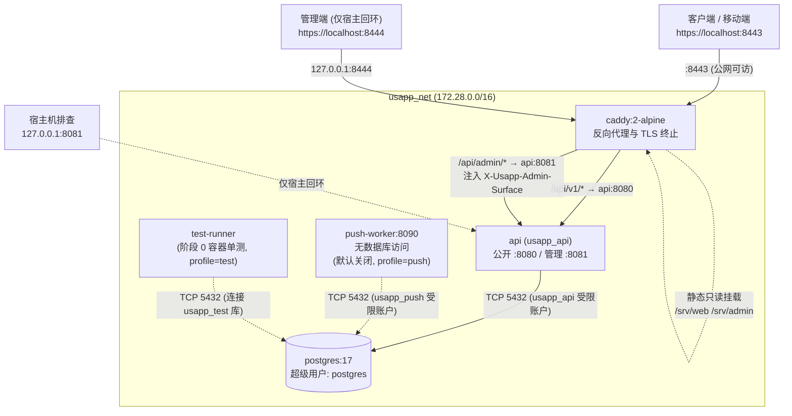

# deploy/ —— 部署编排（阶段 0）

> **状态说明：全部内容尚未执行、尚未验证。**
> 本目录下的 Compose 配置、Caddyfile、Dockerfile **从未被构建或启动过**，
> 亦未进行过真实请求连通性验证。所有构建与运行命令必须**由负责人手动执行**。

---

## 1. 目录结构与作用

| 文件 | 作用 | 状态 |
| --- | --- | --- |
| [docker-compose.yml](docker-compose.yml) | 编排 `postgres` / `api` / `push-worker` / `caddy` / `test-runner` 五服务、固定子网与命名卷 | 已修正环境隔离、权限分离与测试运行器 |
| [Caddyfile](Caddyfile) | 双站点反代：公开站点 `https://localhost:8443` 与管理站点 `https://localhost:8444` | 已配置基线响应头与管理隔离 |
| [Caddyfile.lan](Caddyfile.lan) + [docker-compose.lan.yml](docker-compose.lan.yml) | 局域网 HTTPS 覆盖：公开站点 `https://10.6.245.114:8443`（等于 `PUBLIC_ORIGIN`），localhost:8443 跳转，管理站点不变 | 2026-10-27 已切换；compose 命令须叠加覆盖文件，见 [LOCAL-HTTPS.md](LOCAL-HTTPS.md) 第 9 节 |
| [Dockerfile.api](Dockerfile.api) | C++17 / Drogon API 多阶段构建镜像（含 `builder` / `tester` / `runtime`） | 已补充 `libpq-dev` / `libpq5` 与 `tester` 测试阶段 |
| [Dockerfile.push-worker](Dockerfile.push-worker) | Node.js 24 / TS 推送辅助镜像（多阶段构建） | P2-5c：生产依赖与测试目标分离，已在隔离环境构建 |
| [LOCAL-HTTPS.md](LOCAL-HTTPS.md) | 本地自签 CA 证书生成位置与操作系统信任库手动导入/移除指南 | 文档完备 |
| [docker-entrypoint-initdb.d/01-init-roles.sh](docker-entrypoint-initdb.d/01-init-roles.sh) | 容器首次启动角色初始化：创建受限 `usapp_api` 与 `usapp_push` 账户 | 已配置最小 DML 权限与推送隔离 |
| [.dockerignore](.dockerignore) 与根目录 `/.dockerignore` | 构建上下文排除清单：排除 `.env`、密钥私钥、构建目录与版本管理 | 仓库根目录已创建生效文件 |

> 本目录**不包含任何真实 `.env`**。真实密钥只存在于仓库根目录的 `.env`，由负责人从 `.env.example` 复制后填写，绝不提交至代码库或构建入镜像。

---

## 2. 容器网络与服务拓扑



### 核心安全架构要点

1. **同源架构**：业务 Web 前端与 API 均运行在 `https://localhost:8443` 同源下，无需跨域资源共享（CORS），消除跨域风险。
2. **管理端口严格回环发布**：
   - Caddy 管理站点仅向宿主机发布 `127.0.0.1:8444:8444`，禁止发布至 `0.0.0.0`。
   - API 内部公开监听端口 `8080` 绝不对宿主机发布，外部流量只能经 Caddy 进入。
   - API 内部管理监听器向宿主机发布 `127.0.0.1:8081:8081`，仅供负责人本机直接排查。
3. **数据库账户职责与最小权限分离**：
   - **集群超级用户**（`postgres`）：仅由容器 entrypoint 初始化及负责人手动执行 DDL 迁移、备份恢复时使用。
   - **API 运行账户**（`usapp_api`）：`NOSUPERUSER`，仅拥有业务表与序列的 DML 权限，无权篡改表结构或访问其他数据库。
   - **推送辅助账户**（`usapp_push`）：`NOSUPERUSER`，阶段 0 严格隔离，禁止访问用户、空间、管理员及审计表。
   - **服务环境变量严格按需下发**：Compose 移除全局 `env_file` 广播，各容器仅注入自身所需变量；API 容器不持有超级用户密码，推送容器不持有 `SESSION_SECRET`。
4. **测试运行器容器化隔离**：
   - `test-runner` 服务复用 `Dockerfile.api` 的 `tester` 多阶段构建，在容器内编译运行 12 个测试用例，免除 Windows 宿主编译依赖。
   - 数据库测试通过 Docker 内网直接访问专用测试库 `usapp_test`，无需对外发布 5432 端口。

---

## 3. 端口与暴露面

| 服务 | 容器内监听地址 | 宿主机端口映射 | 安全控制 | 说明 |
| --- | --- | --- | --- | --- |
| `caddy` | `0.0.0.0:8443` | `8443:8443` | TLS 证书 + 基线响应头 | 唯一对外公开业务入口 |
| `caddy` | `0.0.0.0:8444` | `127.0.0.1:8444:8444` | **仅宿主机回环** | 管理控制台站点，禁止公网访问 |
| `api` | `0.0.0.0:8080` | 不发布 | Caddy 代理 | 公开业务接口，不对宿主机暴露 |
| `api` | `0.0.0.0:8081` | `127.0.0.1:8081:8081` | **仅宿主机回环** + CIDR 白名单 | 管理 API，供宿主排查 |
| `push-worker` | `0.0.0.0:8090` | 不发布 | 仅容器私有网络 + 令牌认证 + profile 门控 | 默认不启动；启用须 `PUSH_WORKER_ENABLED=true` 与 `PUSH_WORKER_PRIVATE_NETWORK=true` |
| `postgres` | `0.0.0.0:5432` | 默认不发布 | 仅容器网络内部访问 | 宿主机直连开发时可临时映射 `127.0.0.1:5432:5432` |

---

## 4. 手动操作执行流程（由负责人执行）

### 步骤 1：配置准备（不覆盖现有配置）
```powershell
# 仅当 .env 不存在时复制模板，避免意外覆盖已有配置
if (-not (Test-Path .env)) {
    Copy-Item .env.example .env
    Write-Host "已创建 .env，请编辑填写密钥与口令"
} else {
    Write-Host ".env 已存在，保留现有配置，切勿覆盖"
}
```

### 步骤 2：前端构建产物准备
挂载前必须在宿主机完成构建，生成 `apps/web/dist` 与 `apps/admin/dist`：
```powershell
Set-Location apps\web
pnpm install
pnpm run build

Set-Location ..\admin
pnpm install
pnpm run build

Set-Location ..\..
```

### 步骤 3：Compose 配置静态检查与镜像构建
```powershell
# 校验 Compose 语法与环境变量插值
docker compose -f deploy/docker-compose.yml config

# 构建 api 镜像
docker compose -f deploy/docker-compose.yml build api
```

### 步骤 4：启动数据库并执行迁移
```powershell
# 启动 PostgreSQL 容器并等待健康就绪
docker compose -f deploy/docker-compose.yml up -d postgres
docker compose -f deploy/docker-compose.yml ps

# 执行阶段 0 数据库迁移与角色赋权（通过统一入口 apply.ps1，在容器内以超级用户单事务原子提交）
# Windows PowerShell 5.1:
powershell -NoProfile -ExecutionPolicy Bypass -File database\apply.ps1 -Database usapp -InitRoles
# 或 PowerShell 7+:
# pwsh -NoProfile -File database\apply.ps1 -Database usapp -InitRoles

# 校验迁移版本记录（精确匹配 6 项 BaseName）
docker compose -f deploy/docker-compose.yml exec -T postgres psql -U postgres -d usapp -v ON_ERROR_STOP=1 -c "SELECT version, checksum, applied_at FROM schema_migrations ORDER BY version;"
```

### 步骤 5：容器内运行测试套件（无宿主环境依赖）
```powershell
# 1. 创建测试数据库、应用完整迁移与角色赋权（使用 apply.ps1）
# Windows PowerShell 5.1:
powershell -NoProfile -ExecutionPolicy Bypass -File database\apply.ps1 -Database usapp_test -CreateDatabase -InitRoles
# 或 PowerShell 7+:
# pwsh -NoProfile -File database\apply.ps1 -Database usapp_test -CreateDatabase -InitRoles

# 2. 校验测试库迁移记录
docker compose -f deploy/docker-compose.yml exec -T postgres psql -U postgres -d usapp_test -v ON_ERROR_STOP=1 -c "SELECT version, checksum, applied_at FROM schema_migrations ORDER BY version;"

# 3. 在测试容器内编译并运行全部 12 个测试用例
docker compose -f deploy/docker-compose.yml --profile test run --rm test-runner
```

### 步骤 6：启动全量服务与本地 CA 信任
```powershell
docker compose -f deploy/docker-compose.yml up -d
docker compose -f deploy/docker-compose.yml ps

# 导出 Caddy 根证书并手动导入系统信任库（详见 deploy/LOCAL-HTTPS.md）
New-Item -ItemType Directory -Force -Path deploy\caddy\certs
docker compose -f deploy/docker-compose.yml cp caddy:/data/caddy/pki/authorities/local/root.crt deploy/caddy/certs/root.crt
```

### 步骤 7：健康检查与安全边界点验
```powershell
# 1. 业务面健康检查
curl.exe --cacert deploy/caddy/certs/root.crt https://localhost:8443/api/v1/health

# 2. 管理面健康检查（通过 8444 访问）
curl.exe --cacert deploy/caddy/certs/root.crt https://localhost:8444/api/admin/v1/health

# 3. 验证管理接口无法从业务端口访问（必须返回 404）
curl.exe -i --cacert deploy/caddy/certs/root.crt https://localhost:8443/api/admin/v1/health

# 4. 验证直接访问 8081 缺少 Header 时的防护拦截（预期返回 403）
curl.exe -i http://127.0.0.1:8081/api/admin/v1/health
```

### 步骤 8：非破坏性备份与恢复验证
```powershell
# 1. 在容器内生成二进制转储
docker compose -f deploy/docker-compose.yml exec -T postgres pg_dump -U postgres -d usapp -F c -f /tmp/usapp_stage0.dump
if ($LASTEXITCODE -ne 0) { throw "备份导出失败" }

# 2. 导出到宿主机 backups 目录（杜绝 PowerShell 文本管道转码破坏二进制）
New-Item -ItemType Directory -Force -Path backups
docker compose -f deploy/docker-compose.yml cp postgres:/tmp/usapp_stage0.dump backups/usapp_stage0.dump

# 3. 将备份推入容器进行恢复验证
docker compose -f deploy/docker-compose.yml cp backups/usapp_stage0.dump postgres:/tmp/usapp_restore.dump
docker compose -f deploy/docker-compose.yml exec -T postgres psql -U postgres -v ON_ERROR_STOP=1 -c "CREATE DATABASE usapp_recovery OWNER postgres;"
docker compose -f deploy/docker-compose.yml exec -T postgres pg_restore -U postgres -d usapp_recovery -v /tmp/usapp_restore.dump

# 4. 查询确认恢复库记录完整（包含全部 6 项 BaseName 记录）
docker compose -f deploy/docker-compose.yml exec -T postgres psql -U postgres -d usapp_recovery -v ON_ERROR_STOP=1 -c "SELECT version, checksum, applied_at FROM schema_migrations ORDER BY version;"

# 5. 清理容器内临时文件（保留宿主 backups/usapp_stage0.dump 与 usapp_recovery 库供人工复核）
docker compose -f deploy/docker-compose.yml exec -T postgres rm -f /tmp/usapp_stage0.dump /tmp/usapp_restore.dump
```

---

## 5. 待负责人完成项（外部条件）

1. **依赖锁文件**：`services/push-worker/pnpm-lock.yaml` 已按 P2-5c 授权由包管理器生成（未提交），不可手写。
2. **本地证书安装**：按照 [LOCAL-HTTPS.md](LOCAL-HTTPS.md) 将 `root.crt` 导入当前操作系统受信任根证书颁发机构。
3. **真实网络冲突排查**：若 `172.28.0.0/16` 与宿主机已有 Docker 网络或内网网段冲突，须在 `docker-compose.yml` 及 `.env` 中同步调整。
