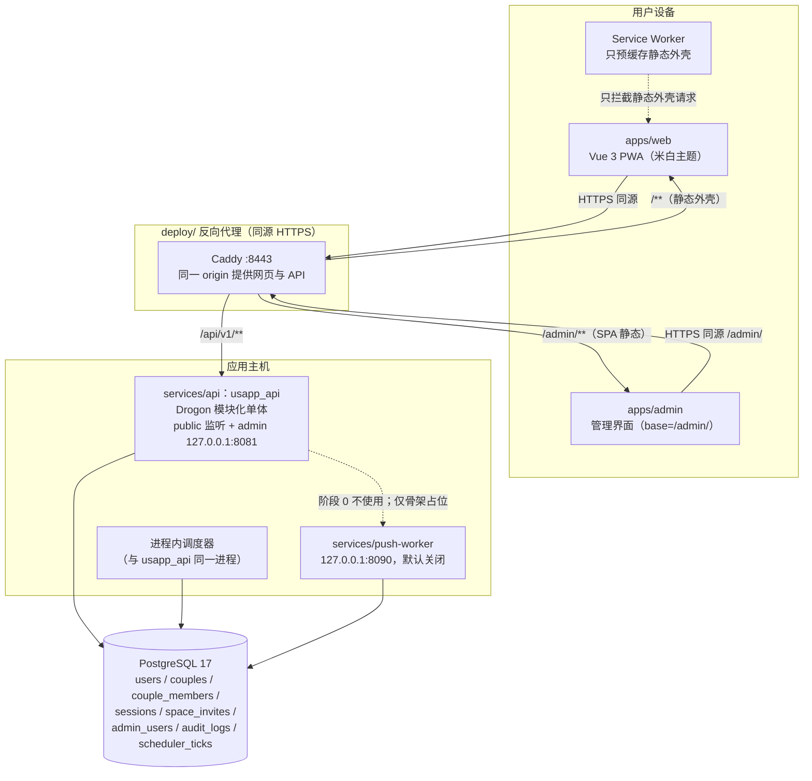

# 架构说明（阶段 0）

> 本文档描述**设计意图与当前仓库快照**。所有内容来自对仓库内文件、`contracts/openapi.yaml` 与
> `database/migrations/*.sql` 的**静态阅读**。本次未执行任何命令：没有构建、没有启动服务、
> 没有连接数据库、没有跑测试。凡标注「仅骨架」「尚未实现」的部分，指的是代码或配置在仓库中不存在或未完成。

---

## 1. 组件图



**关于图中 `deploy/`**：`deploy/` 目录在仓库中存在，含 `docker-compose.yml`、`Caddyfile`、
`Dockerfile.api`、`Dockerfile.push-worker`、`LOCAL-HTTPS.md`、`README.md`。
`deploy/Caddyfile` 定义了**唯一对外站点 `https://localhost:8443`**，用 `tls internal` 由 Caddy
本地 CA 签发证书，并把四类流量分派如下：

| 路径 | 去向 |
| --- | --- |
| `/api/admin/*` | `reverse_proxy api:8081`（管理监听器） |
| `/api/*` | `reverse_proxy api:8080`（公开监听器） |
| `/admin/*` | `handle_path` 剥掉前缀后查 `/srv/admin`（管理端 SPA，`base: '/admin/'`） |
| 其余（兜底） | `/srv/web`（情侣端 SPA，含 history 回退） |

图中 Edge 层的存在因此已被配置文件证实，但**该配置从未被加载验证过**（未执行任何
`docker compose` 命令，`deploy/Caddyfile` 头部注释也自述"尚未在真实环境中加载验证"）。
另有两点必须记住：

- **公开端口在编排内不是 8443。** `.env.example` 的 `API_PUBLIC_PORT=8080` 是容器内的监听口，
  Caddy 转发到它；对外只有 Caddy 的 8443。
- **`ADMIN_ORIGIN=https://localhost:8444` 与这套拓扑不一致**：`deploy/Caddyfile` 里**没有 8444 站点**，
  管理界面就在 `https://localhost:8443/admin/`。`deploy/README.md` 自己把这条列为待决项。
  以哪边为准（改 `.env.example` / `ADMIN_ORIGIN`，还是加一个 8444 站点）属于负责人的决定，
  本文只记录该不一致。

要点：

- **同源**：网页与 API 由同一个 origin 提供，前端不存在跨域请求，服务端也不需要 CORS 头。
  理由是会话 Cookie 用 `__Host-` 前缀（要求 `Secure` + `Path=/` + 不设 `Domain`），
  且状态修改请求要求 `Origin` 精确匹配；这两条只有同源部署才成立。
- **两条监听面**：公开面（情侣端）与管理面（管理端）在后端是两个监听口、两套认证、两类 Cookie。
  管理入口在生产由主机层限制为仅回环可达，应用层再做一次 CIDR 白名单（`AppConfig::adminAllowedCidrs`）。
- **单进程**：调度器跑在 `usapp_api` 主进程内，不引入 Redis、不引入独立调度服务。
- **推送进程**：`services/push-worker` 有 `src/config.ts`、`src/logger.ts`、`src/policy.ts`、
  `src/queue.ts`、`src/server.ts`、`src/index.ts` 与 `tests/*.test.ts`（均已存在），
  默认 `PUSH_WORKER_ENABLED=false`，且 `PUSH_WORKER_HOST` 被强制校验为回环地址。

---

## 2. 模块边界（services/api 模块化单体）

`services/api/CMakeLists.txt` 定义了库 `usapp_core`（静态库）与可执行程序 `usapp_api`，
并把源码按目录切成下列模块：

| 模块目录 | 职责 | 当前仓库状态 |
| --- | --- | --- |
| `src/core/` | 环境变量读取（`Env.h/.cc`）、密码学原语（`Crypto.h/.cc`：SHA-256、CSPRNG、FNV-1a 64、PBKDF2）、统一错误信封（`Errors.h/.cc`） | 已实现（文件存在） |
| `src/config/` | 进程级配置与启动期校验（`AppConfig.h/.cc`），密钥只来自环境变量 | 已实现（文件存在） |
| `src/db/` | 连接池与数据访问封装（`Db.h/.cc`） | 已实现（文件存在） |
| `src/http/` | HTTP 层安全不变量：Cookie 构造、Origin 判定、CSRF 判定、CIDR 匹配、请求 ID（`HttpUtil.h/.cc`） | 已实现（文件存在） |
| `src/services/` | 业务服务：`AuthService`（邮箱验证码登录）、`SessionService`（会话与 CSRF 的数据库侧）、`RegistrationPolicy`（注册白名单） | 已实现（文件存在） |
| `src/mailer/` | 邮件发送（SMTP / 日志模式） | 已实现（`Mailer.h/.cc` 文件存在） |
| `src/scheduler/` | 进程内调度、advisory lock 与 tick 记录 | 已实现（`Scheduler.h/.cc`、`LockKey.h/.cc`、`jobs/SchedulerHeartbeatJob.h/.cc` 文件存在） |
| `src/controllers/` | HTTP 控制器：Health、Session、Auth、Space、Invite、Admin | **尚未实现**：`CMakeLists.txt` 第 55～60 行逐个列出了六个 `.cc`，但这些文件**均不存在**；`src/main.cc`（第 54 行）同样不存在 |

模块化单体的边界规则：

1. `usapp_core` 内部只依赖 Drogon / OpenSSL / libcurl / jsoncpp，不做进程间调用。
2. 控制器只负责 HTTP 编解码、安全前置校验与事务边界，不写业务判定。
3. 业务判定集中在 `services/`，且**同一次业务动作只在一个数据库事务里完成**。
4. 安全不变量只在 `src/http/HttpUtil.h/.cc` 实现一份（该文件头注释明确写了这条规则），
   避免"某处忘了校验 Origin"这类分散实现带来的漏洞。

### 为什么是模块化单体，而不是微服务

阶段 0 选择模块化单体的直接收益是**删掉一批分布式系统独有的失败模式**：网络分区与超时、
重试导致的重复结算、跨服务分布式事务、服务发现与配置漂移、消息队列的投递语义、跨服务链路追踪、
多份部署与版本偏斜、跨服务鉴权传递、时钟不一致、队列积压与背压、多服务各自的连接池耗尽、
部分失败下的中间态、跨服务幂等键管理、以及这些问题的联调与排障成本
（阶段 0 评估中这类失败模式合计对应约 **15.5 分**的扣分项）。

代价是**将来需要一次重新拆分**：如果后续某个模块（例如媒体资产或通知投递）确实需要独立伸缩或
独立发布节奏，就要把已经写在一个进程里的代码重新按服务边界切开。这个代价是被明确接受的——
阶段 0 的目标是先把安全基线与数据模型做对，而不是先建立服务拓扑。

---

## 3. 请求管线

```
请求
 └─ 1. Origin / CIDR 前置检查
       · 状态修改方法（非 GET/HEAD/OPTIONS）：Origin 必须与会话面预期的 origin 精确相等
         （`AppConfig::isAllowedPublicOrigin` / `isAllowedAdminOrigin` + `http::originMatches`）
       · 管理面：调用方地址必须落在 `adminAllowedCidrs` 内（`http::ipInAnyCidr`）
       · 任一不满足 → 403 `ORIGIN_NOT_ALLOWED`，不进入后续阶段
 └─ 2. 会话装载
       · 读 Cookie `__Host-usapp-session`（管理面为 `__Host-usapp-admin`）
       · `SessionService::loadByRawToken` 只按 SHA-256 查 `sessions` 表
       · 查不到 / 已撤销 / 已过期 → 匿名（fail closed，不复活、不延长）
 └─ 3. 状态修改方法的 CSRF 校验
       · 读 `X-CSRF-Token`，与会话行绑定的 `csrf_token_hash` 做恒定时间比较
         （`SessionService::verifyCsrf`，数据库只保存 SHA-256）
       · 失败 → 403 `CSRF_TOKEN_INVALID`
       · GET/HEAD/OPTIONS 跳过本阶段（`http::requiresCsrf`）
 └─ 4. controller      —— 参数校验、错误码映射（`core/Errors.h`）
 └─ 5. service         —— 业务判定；白名单只在"是否允许创建新账号"这一步生效
 └─ 6. 事务            —— 一次业务动作一个事务；提交后再做网络操作（发信、推送）
```

管线顺序是刻意的：Origin/CIDR 在会话装载之前（最便宜的检查最先做，也避免对不可信来源查库），
CSRF 在控制器之前（业务代码不应该有机会先执行副作用）。

已落地的两条事务边界约定（见 `src/services/AuthService.h` 的注释与 0004 迁移的表注释）：

- **验证码登录**：`SELECT ... FOR UPDATE` 锁住验证码行 → 校验 attempts/expires/散列 →
  白名单判定 → 插入或取回用户 → 消费验证码 → 撤销旧预认证会话并新建正式会话，全部同一事务。
- **调度 tick**：见 `docs/scheduler.md`——加锁的数据库语句与锁在**同一连接、同一事务**；
  网络操作只在提交之后发生。

---

## 4. 信任边界与权威判定方

| 检查项 | 权威组件 | 说明 |
| --- | --- | --- |
| 请求来源（Origin） | `usapp_api`（`AppConfig` + `http::originMatches`） | 精确字符串匹配 scheme+host+port，不用前缀/后缀匹配；`https://evil.com` 不因包含 `localhost` 被放行 |
| 会话有效性 | `usapp_api` + `sessions` 表 | Cookie 是 64 字符不透明随机串，数据库只存 SHA-256 |
| CSRF | `usapp_api`（数据库散列）+ 前端内存令牌 | 令牌只存内存，绝不落 localStorage/cookie；登录成功时随会话标识一起轮换 |
| 管理面可达性 | 主机层（端口只发布到回环）**与** 应用层 CIDR 白名单 | 应用层是第二道防线，不是唯一防线 |
| 注册白名单 | `usapp_api`（`RegistrationPolicy`） | 只决定"能否创建新账号"；已有账号永远可登录；不授予任何权限 |
| 空间成员上限 | PostgreSQL（`couple_members` 的唯一约束） | `UNIQUE(user_id)` + `UNIQUE(couple_id, slot)` + `slot IN (1,2)`；应用层并发再快也绕不过数据库 |
| 空间容量语义 | 数据库约束 + 业务代码 | 容量由 slot 域定义，**没有** `max_members` 列 |
| 客户端缓存边界 | 服务端 `Cache-Control: no-store` 为权威，Service Worker 策略为配合 | Service Worker 只缓存静态外壳 |
| 管理权限 | `usapp_api` + `admin_users` / `admin_sessions` | 与 `users` 完全分离：没有耦合列、没有外键；前端不做任何权限判断 |

补充说明：

- 前端（`apps/web`、`apps/admin`）的隐藏按钮、路由守卫、内存状态都**不是**授权依据，
  只是渲染依据。管理端客户端源码里明确写了"本文件中没有任何 `isAdmin` / `hasPermission` 之类的逻辑"。
- 浏览器把 `onLine === false` 视为离线，此时任何非 GET 请求在客户端就被拦下
  （`OfflineMutationBlockedError`），不发出业务写请求。

---

## 5. 已预留但**尚未实现**的设计约束

以下约束已在阶段 0 的设计中**预留**（数据模型与命名空间有位置，或已被写入设计要求），
但阶段 0 **不实现**任何一条：

1. **发布后关键任务编辑需接收方确认**：当前周期发布之后，对关键任务的编辑必须征得接收方确认。阶段 0 无任务与周期概念。
2. **移除显式「开始任务」按钮**：任务不设显式"开始"动作。阶段 0 无任务实体，因此按钮与状态机都未实现。
3. **已扣费小红花兑换的取消需双方同意**：一旦扣费，取消兑换必须双方同意。阶段 0 无小红花与资产结算。
4. **普通通知默认关闭，并按「用户 + 操作类型」记忆上一次选择**。阶段 0 无通知投递与用户偏好表。
5. **个人连胜按自然日计**：只要当天至少有一个任务周期完成结算，该天就计入个人连胜。阶段 0 无结算。
6. **共享内容使用彼此独立的表，不设 `shared_contents` 父表**。阶段 0 未创建任何共享内容表。
7. **READY 原图需要独立的媒体备份，并且必须有一次恢复演练**。阶段 0 不接收原图，
   媒体备份被明确排除在 `docs/backup-restore.md` 范围之外。
8. **空间时区**：阶段 0 固定写入 `Asia/Shanghai`，但保留 `couples.timezone` 列以便后续按空间调整
   （0003 迁移的列注释写明"自然日结算必须以本列为准，禁止用 UTC 直接切日"）。
9. **邀请的消费与加入在单事务内完成**（契约已声明，实现待补）：`POST /api/v1/invites/{code}/accept`
   必须在一个事务内完成行锁读取、容量校验、成员插入与 `used_count` 递增。

> 这些是**预留**，不是已交付能力。任何把它们当作"阶段 0 已完成"的文档都是错的。

---

## 6. 已实现 / 仅骨架 / 尚未实现

### 已实现（文件存在且内容完整，仍未执行验证）

- `contracts/openapi.yaml`：阶段 0 冻结的 OpenAPI 3.1 契约（健康、会话、认证、空间、邀请、管理接口）。
- `database/migrations/0000_schema_migrations.sql` 至 `0005_admin_audit.sql`：6 个迁移文件，
  覆盖迁移表、公共函数/触发器、身份与验证码、情侣绑定与邀请、调度 tick、管理账号与审计日志。
- `services/api/src/{core,config,db,http,services,mailer,scheduler}/**`：错误信封、密码学原语、配置、
  连接池封装、HTTP 安全工具、认证与会话服务、注册白名单策略、邮件发送、
  进程内调度器与 advisory-lock 锁键派生（`scheduler/LockKey.h/.cc`、`scheduler/Scheduler.h/.cc`、
  `scheduler/jobs/SchedulerHeartbeatJob.h/.cc`）。
- `apps/web`：Vue 3 + TS + Vite + `vite-plugin-pwa`（`injectManifest`）客户端，含内存态会话/空间 store、
  内存态 CSRF 持有者、离线提示条、Service Worker 与缓存策略。
- `apps/admin`：Vue 3 管理界面骨架（`base: '/admin/'`，不做 PWA，不持久化任何状态）。
- `services/push-worker`：配置解析与日志骨架，强制回环绑定，默认关闭。
- `database/apply.ps1`：迁移应用脚本（负责人手动执行）。
- `database/tests/constraints_test.sql`、`database/tests/advisory_lock_test.ps1`：约束与锁语义测试（只编写）。
- `apps/web/tests/unit/*`、`apps/admin/tests/unit/*`：前端单测文件（只编写）。

### 仅骨架

- `services/api/src/controllers/**` 与 `src/main.cc`：`CMakeLists.txt` 第 54～60 行逐个列出了
  它们，但这些文件**不存在**。因此 `usapp_api` 目前无法编译成功
  （`usapp_core` 的源码由 `file(GLOB_RECURSE ...)` 收集，不列文件名，
  所以 `src/mailer/**`、`src/scheduler/**` 存在与否不影响该结论）。
- `services/push-worker`：`package.json` 的 `start` 指向 `dist/index.js`，
  而 `tsconfig.json` 的输出目录与 `src/` 布局之间存在未核对的落差：
  `src/index.ts` 与 `src/tests/*.test.ts` 都已存在，但构建产物路径本次未验证。
- `apps/admin` 的视图均为骨架视图（概览、用户、情侣空间、审计日志、登录、404），
  数据来自契约定义的列表接口，尚未与真实后端联调。

### 尚未实现

- 阶段 1～5 的全部业务：任务、奖励、小红花结算、阳光值、留言、照片、角色、成就、推送投递。
- 任何调度**任务结算**：阶段 0 只有锁基础与 tick 记录表，没有作业体（见 `docs/scheduler.md`）。
- 媒体：原图接收、私有 OSS 直传、媒体备份与恢复演练。
- `deploy/` 本身**已存在但未经运行验证**：`docker compose` 从未执行过，
  Caddy 配置从未加载过，本地 CA 从未导出或导入信任库（见 `deploy/LOCAL-HTTPS.md`）。
  另外 `ADMIN_ORIGIN=https://localhost:8444` 与 `deploy/Caddyfile` 的单站点拓扑不一致。
- 管理端的写操作与用户/空间管理动作（契约只定义了只读列表与登录/注销）。

---

## 7. 尚未执行的检查

以下检查**本次一律没有执行**，也不应被任何文档描述成"已通过"：

1. 没有执行 `cmake` 配置或编译，因此没有验证 `usapp_api` / `usapp_core` 能否构建。
2. 没有运行 `database/apply.ps1`，没有验证任何迁移能在真实 PostgreSQL 17 上应用成功。
3. 没有运行 `database/tests/constraints_test.sql` 与 `database/tests/advisory_lock_test.ps1`。
4. 没有运行 `apps/web` / `apps/admin` 的 `vitest`，没有跑类型检查，没有执行 `vite build`。
5. 没有启动 Caddy，没有验证同源 HTTPS、Cookie 属性、`Origin` 精确匹配或管理面 CIDR 拦截。
6. 没有启动 `services/push-worker`，没有验证回环绑定校验与配置失败退出行为。
7. 没有对 `contracts/openapi.yaml` 做契约测试或 schema 校验。
8. 没有执行 `docs/backup-restore.md` 中的备份/恢复流程。

---

## 附：本文档依据的文件

- `README.md`
- `contracts/openapi.yaml`
- `database/migrations/0000_schema_migrations.sql`、`0001_common.sql`、`0002_identity.sql`、
  `0003_couple_binding.sql`、`0004_scheduler.sql`、`0005_admin_audit.sql`
- `database/apply.ps1`、`database/tests/advisory_lock_test.ps1`
- `services/api/CMakeLists.txt`
- `services/api/src/core/{Crypto.h,Errors.h,Errors.cc}`
- `services/api/src/config/AppConfig.h`
- `services/api/src/http/HttpUtil.h`
- `services/api/src/services/{AuthService.h,SessionService.h,RegistrationPolicy.h}`
- `services/push-worker/{package.json,src/config.ts}`
- `deploy/Caddyfile`、`deploy/LOCAL-HTTPS.md`、`deploy/docker-compose.yml`（仅目录清单与 Caddyfile 全文）
- `apps/web/{package.json,vite.config.ts,src/pwa/cache-policy.ts,src/pwa/sw.ts,src/pwa/register-sw.ts,src/api/client.ts,src/api/csrf.ts,src/stores/session.ts,src/stores/space.ts,src/components/OfflineBanner.vue}`
- `apps/admin/{package.json,vite.config.ts,src/api/client.ts,src/stores/admin-session.ts}`
- `.env.example`、`.gitignore`
